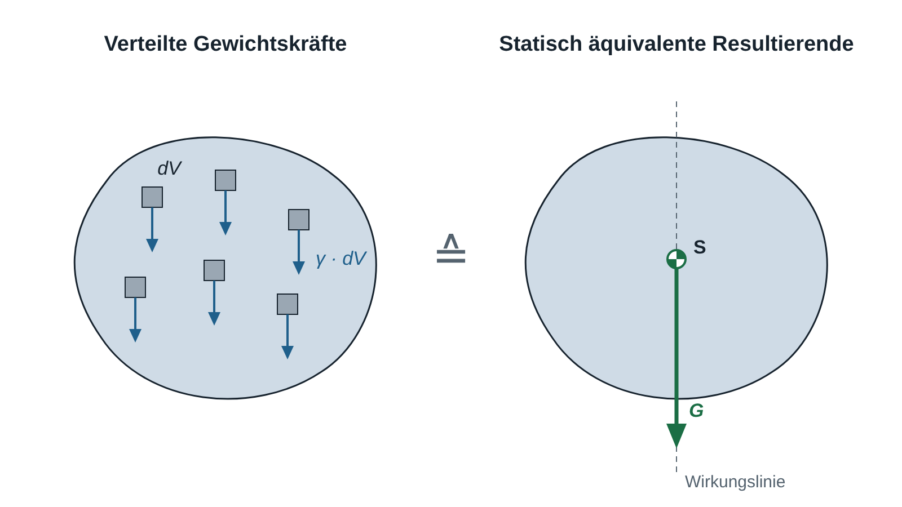
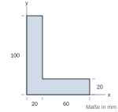
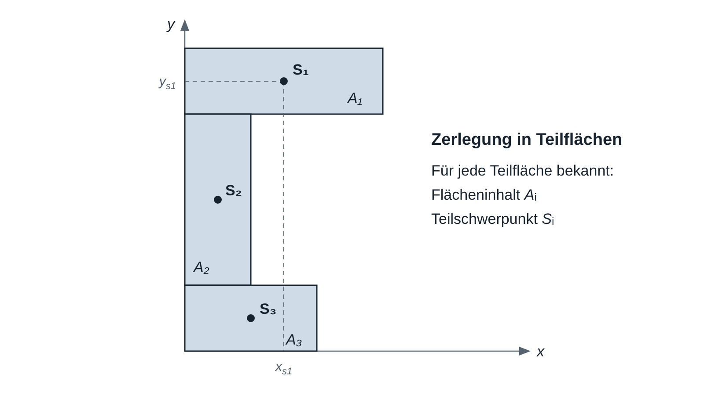
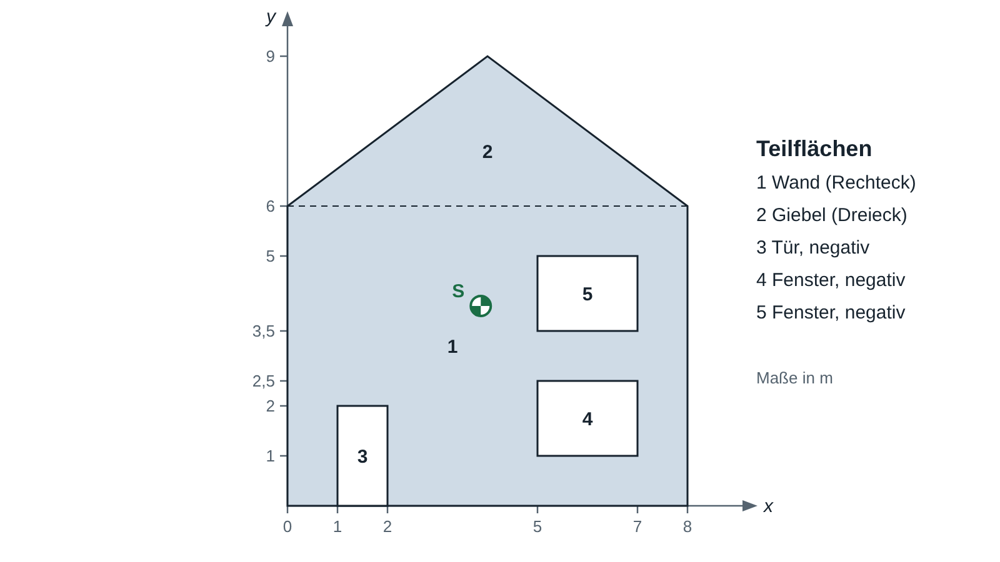
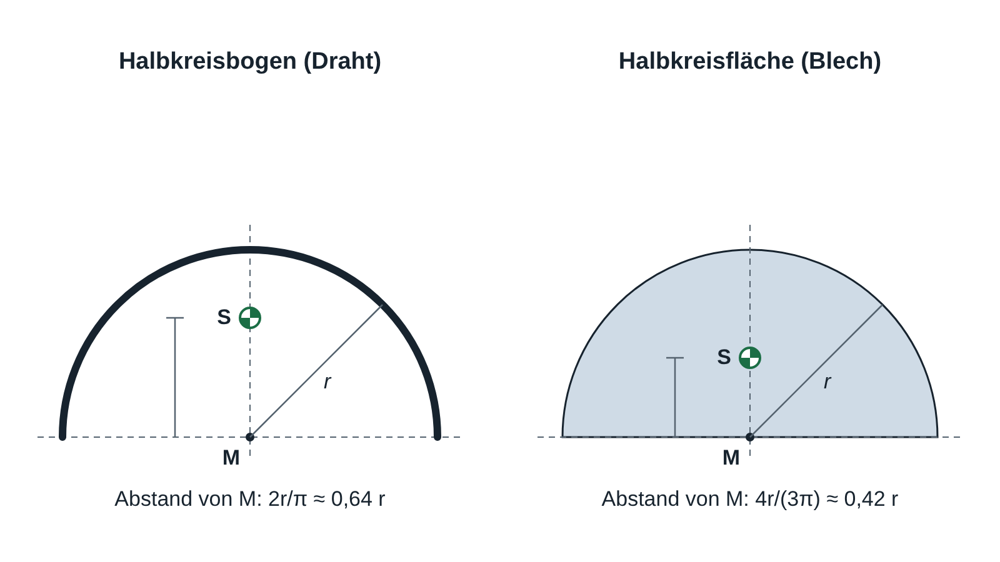

Jana Keller, Werkstudentin in einem Stahlbaubetrieb, soll einen L-förmigen Blechzuschnitt mit dem Hallenkran umsetzen. Sie schlägt den Haken dort an, wo sie die Mitte des Blechs vermutet. Beim Anheben kippt das Blech zur Seite und hängt schief am Haken. Der Meister fragt sie, wo der Schwerpunkt des Zuschnitts liegt. Keller kann das nicht abschätzen und fragt sich, wie man diesen Punkt für eine zusammengesetzte Form berechnet.

::::::: {.callout-note .ez-block title="Bevor Sie weiterlesen: Wie sehen Sie das?"}
*Wie sehr stimmen Sie den drei Aussagen zu? Jede Aussage wird an der Stelle aufgelöst, die sie beantwortet. Wer sich vorher festlegt, liest gezielter.*

::: {#ez-1 .einschaetzung}
Der Schwerpunkt eines Körpers ist immer sein geometrischer Mittelpunkt.

[Auflösung im ersten Abschnitt](#sec-abschnitt-1){.ez-verweis}
:::

::: {#ez-2 .einschaetzung}
Der Schwerpunkt einer L-förmigen Fläche liegt in der Mitte des Rechtecks, das die Fläche umschließt.

[Auflösung im zweiten Abschnitt](#sec-abschnitt-2){.ez-verweis}
:::

::: {#ez-3 .einschaetzung}
Ein Halbkreisbogen aus Draht und eine Halbkreisfläche aus Blech mit gleichem Radius haben denselben Schwerpunkt.

[Auflösung im dritten Abschnitt](#sec-abschnitt-3){.ez-verweis}
:::
:::::::

:::: {.callout-note .lernziele title="Lernziele: Nach dieser Einheit können Sie …"}
1.  erklären, unter welcher Voraussetzung Schwerpunkt und Volumenmittelpunkt eines Körpers zusammenfallen;
2.  den Schwerpunkt einer aus Teilflächen zusammengesetzten Fläche berechnen und das Ergebnis auf Plausibilität prüfen;
3.  Linienschwerpunkt und Flächenschwerpunkt unterscheiden und den Schwerpunkt zusammengesetzter Linien berechnen.
::::

## Der Schwerpunkt eines Körpers {#sec-abschnitt-1}

::: ersetzen
**ROHENTWURF der KI:** Der Text dieses Abschnitts ist ein Entwurf nach Ihrem Foliensatz. Prüfen Sie ihn fachlich, überarbeiten Sie ihn in Ihren Worten und löschen Sie danach diesen Kasten.
:::

Auf jedes Volumenteilchen $\mathrm{d}V$ eines Körpers wirkt die kleine Gewichtskraft $\gamma\,\mathrm{d}V$; dabei ist $\gamma$ das spezifische Gewicht. Gesucht ist die eine Kraft $G$, die diesen verteilten Kräften statisch äquivalent ist (@fig-abb-01). Ihr Betrag ergibt sich durch Aufaddieren aller Teilkräfte, beim homogenen Körper also $G = \gamma\,V$. Ihre Wirkungslinie folgt aus der Bedingung, dass $G$ bezüglich jeder Koordinatenachse dasselbe Moment hat wie die verteilten Kräfte. Der Punkt, durch den die Wirkungslinie bei jeder Richtung der Schwerkraft geht, heißt Schwerpunkt $S$.

{#fig-abb-01 width="85%" fig-alt="Links ein Körper mit mehreren Volumenteilchen und kleinen Gewichtskräften, rechts derselbe Körper mit einer einzigen Gewichtskraft G im Schwerpunkt S"}

Beim homogenen Körper kürzt sich $\gamma$ heraus, und es bleibt

$$
x_s = \frac{\int x\,\mathrm{d}V}{\int \mathrm{d}V}, \qquad
y_s = \frac{\int y\,\mathrm{d}V}{\int \mathrm{d}V}, \qquad
z_s = \frac{\int z\,\mathrm{d}V}{\int \mathrm{d}V}.
$$

Der Schwerpunkt ist dann der Volumenmittelpunkt und hängt nur von der Form ab. Zwei Sonderfälle sparen Rechenarbeit. Besitzt der Körper eine Symmetrieachse, liegt $S$ auf ihr. Bei einer Scheibe mit konstanter Dicke $t$ gilt $\mathrm{d}V = t\,\mathrm{d}A$; die Dicke kürzt sich, und man erhält den Flächenschwerpunkt

$$
x_s = \frac{\int x\,\mathrm{d}A}{\int \mathrm{d}A}, \qquad
y_s = \frac{\int y\,\mathrm{d}A}{\int \mathrm{d}A}.
$$

::: {.callout-tip title="Lernspiel: Grundbegriffe zum Schwerpunkt"}
Mit diesem Memory rufen Sie die acht Grundbegriffe der Einheit aus dem Gedächtnis ab (Lernziel 1). Decken Sie je zwei Karten auf und finden Sie zu jedem Begriff die passende Definition; einige Begriffe werden erst in den folgenden Abschnitten erklärt, legen Sie sich trotzdem fest. Nach jedem Versuch erklärt die Rückmeldung, warum die beiden Karten zusammengehören oder nicht.

<iframe class="lernspiel" src="interactions/spiel-01.html" height="560" loading="lazy" title="Memory: Begriffe und Definitionen">

</iframe>
:::

::: {.callout-tip .ez-pruefen title="Ihre Einschätzung prüfen"}
*„Der Schwerpunkt eines Körpers ist immer sein geometrischer Mittelpunkt.“* []{.ez-ihre data-ez="ez-1"}

**Auflösung: teils.** Das gilt nur für homogene Körper mit konstanter Dichte; dann fällt der Schwerpunkt mit dem Volumenmittelpunkt zusammen. Ist das Gewicht ungleichmäßig verteilt, verschiebt sich der Schwerpunkt zur schwereren Seite.
:::

## Der Schwerpunkt zusammengesetzter Flächen {#sec-abschnitt-2}

::: {.callout-note icon=false title="Vorhersage: Wo liegt der Schwerpunkt?"}
{width="60%" fig-alt="L-Fläche: stehendes Rechteck 20 mal 100 mm, rechts unten angesetztes liegendes Rechteck 60 mal 20 mm"}

Diese Aufgabe steht absichtlich vor der Erklärung des Rechenwegs: Wer sich zuerst festlegt, erkennt danach leichter, wo die eigene Vorstellung abweicht (Lernziel 2). Bevor Sie weiterlesen und ohne zu rechnen:

1.  Schätzen Sie die Koordinaten des Schwerpunkts $S$ und notieren Sie $x_s$ und $y_s$ in mm.
2.  Begründen Sie Ihre Schätzung in einem Satz.
3.  Liegt $S$ im Material oder außerhalb? Legen Sie sich fest.
:::

::: {.callout-tip collapse="true" icon=false title="Auflösung (erst nach Ihrer Schätzung öffnen)"}
Zerlegung in zwei Teilflächen mit bekannten Schwerpunkten:

| Teilfläche | $A_i$ in mm² | $x_{si}$ in mm | $y_{si}$ in mm |
|---|---|---|---|
| 1 (stehend, 20 × 100) | 2000 | 10 | 50 |
| 2 (liegend, 60 × 20) | 1200 | 50 | 10 |

$$
x_s = \frac{\sum A_i\,x_{si}}{\sum A_i} = \frac{2000\cdot 10 + 1200\cdot 50}{3200} = 25\ \text{mm},
\qquad
y_s = \frac{\sum A_i\,y_{si}}{\sum A_i} = \frac{2000\cdot 50 + 1200\cdot 10}{3200} = 35\ \text{mm}
$$

**Vergleichen Sie mit Ihrer Schätzung:**

-   Haben Sie etwa $(40 \mid 50)$ geschätzt? Das ist die Mitte des umschließenden Rechtecks. Sie wäre nur richtig, wenn die Fläche dieses Rechteck ganz ausfüllte. Hier fehlt die Ecke oben rechts, deshalb rückt $S$ nach links unten.
-   $S$ liegt bei $(25 \mid 35)$ und damit **außerhalb des Materials**, im freien Winkel der L-Fläche. Ein Schwerpunkt muss nicht im Körper liegen.
-   $S$ liegt auf der Strecke zwischen den beiden Teilschwerpunkten und näher an der größeren Teilfläche 1.
:::

::: ersetzen
**ROHENTWURF der KI:** Der Text dieses Abschnitts ist ein Entwurf nach Ihrem Foliensatz. Prüfen Sie ihn fachlich, überarbeiten Sie ihn in Ihren Worten und löschen Sie danach diesen Kasten.
:::

Viele Querschnitte lassen sich in Teilflächen zerlegen, deren Flächeninhalt $A_i$ und Schwerpunkt $(x_{si} \mid y_{si})$ bekannt sind (@fig-abb-02). Das Integral über die Gesamtfläche wird dann zur Summe über die Teilflächen:

$$
x_s = \frac{\sum x_{si}\,A_i}{\sum A_i}, \qquad
y_s = \frac{\sum y_{si}\,A_i}{\sum A_i}.
$$

{#fig-abb-02 width="85%" fig-alt="Eine Fläche aus drei Rechtecken A1, A2 und A3 im x-y-Koordinatensystem; in jedem Rechteck ist der Teilschwerpunkt markiert, für S1 sind die Koordinaten eingetragen"}

Jede Teilfläche geht mit ihrer Größe gewichtet ein, der Schwerpunkt liegt deshalb näher an den großen Teilflächen. Das Vorgehen gilt nicht nur für Rechtecke, sondern für alle Teilflächen mit bekanntem Schwerpunkt, etwa Dreiecke und Kreise; Werte für einfache Flächen stehen in Tabellen [@gross2024].

In der Rechnung hilft eine feste Reihenfolge: Koordinatensystem festlegen, Fläche zerlegen, für jede Teilfläche $A_i$, $x_{si}$ und $y_{si}$ in eine Tabelle eintragen, Summen bilden und dividieren. Prüfen Sie das Ergebnis anschließend auf Plausibilität: Der Schwerpunkt liegt innerhalb des umschließenden Rechtecks, auf einer vorhandenen Symmetrieachse und bei zwei Teilflächen auf der Strecke zwischen den beiden Teilschwerpunkten. Im Material muss er nicht liegen.

### Beispiel: Hausfassade mit Tür und Fenstern {#sec-beispiel-fassade}

Gesucht ist der Flächenschwerpunkt der Fassade in @fig-abb-04. Der Umriss besteht aus einem Rechteck (Wand) und einem Dreieck (Giebel). Tür und Fenster sind Aussparungen: Dort fehlt Fläche. Man behandelt sie wie jede andere Teilfläche, setzt ihren Flächeninhalt aber **negativ** an.

{#fig-abb-04 width="85%" fig-alt="Fassade im x-y-Koordinatensystem: Wand 8 m breit und 6 m hoch, darüber ein 3 m hoher Giebel, links unten eine Tür, rechts zwei Fenster übereinander; der Schwerpunkt liegt etwas links der Mitte auf 4 m Höhe"}

Der Schwerpunkt eines Dreiecks liegt auf einem Drittel der Höhe über der Grundseite, beim Giebel also bei $y_{s2} = 6 + 3/3 = 7\ \text{m}$. Damit ergibt sich die Tabelle:

| $i$ | Teilfläche | $A_i$ in m² | $x_{si}$ in m | $y_{si}$ in m | $x_{si}\,A_i$ in m³ | $y_{si}\,A_i$ in m³ |
|:-:|:---|--:|--:|--:|--:|--:|
| 1 | Wand, Rechteck 8 × 6 | 48 | 4 | 3 | 192 | 144 |
| 2 | Giebel, Dreieck mit Grundseite 8 und Höhe 3 | 12 | 4 | 7 | 48 | 84 |
| 3 | Tür, 1 × 2 | −2 | 1,5 | 1 | −3 | −2 |
| 4 | Fenster unten, 2 × 1,5 | −3 | 6 | 1,75 | −18 | −5,25 |
| 5 | Fenster oben, 2 × 1,5 | −3 | 6 | 4,25 | −18 | −12,75 |
|   | **Summe** | **52** |  |  | **201** | **208** |

$$
x_s = \frac{\sum x_{si}\,A_i}{\sum A_i} = \frac{201}{52} \approx 3{,}87\ \text{m},
\qquad
y_s = \frac{\sum y_{si}\,A_i}{\sum A_i} = \frac{208}{52} = 4{,}00\ \text{m}
$$

**Plausibilitätsprüfung:** Ohne Aussparungen läge der Schwerpunkt wegen der Symmetrie bei $x_s = 4{,}00\ \text{m}$ und bei $y_s = 228/60 = 3{,}80\ \text{m}$. Die beiden Fenster nehmen rechts Fläche weg, deshalb rückt $S$ um 0,13 m nach links. Die Aussparungen liegen überwiegend im unteren Teil, deshalb rückt $S$ um 0,20 m nach oben. Der Schwerpunkt entfernt sich also von den Aussparungen.

**Typischer Fehler:** Die Aussparungen werden im Zähler abgezogen, in der Flächensumme im Nenner aber vergessen. Das negative Vorzeichen gilt in beiden Summen.

::: {.callout-tip title="Lernspiel: Wie wandert der Schwerpunkt?"}
Mit der Simulation üben Sie, die Lage des Schwerpunkts abzuschätzen, bevor Sie rechnen (Lernziel 2). Stellen Sie die Länge $b$ der L-Fläche ein, tragen Sie Ihre Schätzung für $x_s$ und $y_s$ ein und wählen Sie erst dann „Schätzung prüfen“; wiederholen Sie das für mindestens drei Längen. Die Rückmeldung zeigt den berechneten Punkt mit Rechnung und erklärt, warum Ihre Schätzung abweicht.

<iframe class="lernspiel" src="interactions/spiel-02.html" height="620" loading="lazy" title="Simulation: Schwerpunkt einer L-Fläche">

</iframe>
:::

::: {.callout-tip .ez-pruefen title="Ihre Einschätzung prüfen"}
*„Der Schwerpunkt einer L-förmigen Fläche liegt in der Mitte des Rechtecks, das die Fläche umschließt.“* []{.ez-ihre data-ez="ez-2"}

**Auflösung: nein.** Jede Teilfläche geht mit ihrer Größe gewichtet in die Rechnung ein, und die fehlende Ecke zieht den Schwerpunkt von der Rechteckmitte weg. Er kann dabei sogar außerhalb des Materials liegen.
:::

## Der Linienschwerpunkt {#sec-abschnitt-3}

::: ersetzen
**ROHENTWURF der KI:** Der Text dieses Abschnitts ist ein Entwurf nach Ihrem Foliensatz. Prüfen Sie ihn fachlich, überarbeiten Sie ihn in Ihren Worten und löschen Sie danach diesen Kasten.
:::

Bei dünnen Stäben, Drähten oder Seilen ist das Gewicht entlang einer Linie verteilt. Bei konstantem Querschnitt mit Dicke $t$ und Breite $b$ gilt $\mathrm{d}V = t\,b\,\mathrm{d}s$; Dicke und Breite kürzen sich, und es bleibt der Linienschwerpunkt

$$
x_s = \frac{\int x\,\mathrm{d}s}{\int \mathrm{d}s}, \qquad
y_s = \frac{\int y\,\mathrm{d}s}{\int \mathrm{d}s}.
$$

Für Linien aus $n$ Teillinien mit den Längen $l_i$ und bekannten Teilschwerpunkten gilt entsprechend

$$
x_s = \frac{\sum x_{si}\,l_i}{\sum l_i}, \qquad
y_s = \frac{\sum y_{si}\,l_i}{\sum l_i}.
$$

Gewichtet wird also mit Längen und nicht mit Flächen. Deshalb hat derselbe Umriss als Draht einen anderen Schwerpunkt als als Blech (@fig-abb-03): Beim Halbkreisbogen mit Radius $r$ liegt der Schwerpunkt im Abstand $2r/\pi \approx 0{,}64\,r$ vom Kreismittelpunkt, bei der Halbkreisfläche im Abstand $4r/(3\pi) \approx 0{,}42\,r$ [@gross2024]. In beiden Fällen liegt er auf der Symmetrieachse, beim Draht jedoch an einer Stelle, an der sich kein Material befindet.

{#fig-abb-03 width="85%" fig-alt="Links ein Halbkreisbogen, dessen Schwerpunkt im Abstand 2r durch Pi vom Mittelpunkt liegt, rechts eine Halbkreisfläche, deren Schwerpunkt näher am Mittelpunkt liegt"}

::: {.callout-tip .ez-pruefen title="Ihre Einschätzung prüfen"}
*„Ein Halbkreisbogen aus Draht und eine Halbkreisfläche aus Blech mit gleichem Radius haben denselben Schwerpunkt.“* []{.ez-ihre data-ez="ez-3"}

**Auflösung: nein.** Beim Draht liegt das gesamte Gewicht auf dem Bogen, beim Blech auch im Inneren nahe dem Durchmesser. Der Schwerpunkt des Drahtes liegt deshalb weiter vom Kreismittelpunkt entfernt als der des Blechs.
:::

## Lern-Check {#sec-lerncheck}

::: {.callout-tip title="Lern-Check: Was ist hängen geblieben?"}
Der Lern-Check prüft jedes der drei Lernziele mit einer Frage; er wird nicht benotet. Wählen Sie pro Frage eine Antwort, ohne zurückzublättern. Die Rückmeldung erklärt danach jede Option, auch die falschen.

<iframe class="lernspiel" src="interactions/spiel-03.html" height="720" loading="lazy" title="Lern-Check mit erklärender Rückmeldung">

</iframe>
:::

:::: {.callout-tip title="Kernaussagen"}
1.  Beim homogenen Körper fällt der Schwerpunkt mit dem Volumenmittelpunkt zusammen. Bei einer Scheibe mit konstanter Dicke genügt deshalb der Flächenschwerpunkt.
2.  Für zusammengesetzte Flächen gilt $x_s = \sum A_i\,x_{si} / \sum A_i$ und entsprechend für $y_s$. Aussparungen gehen als negative Flächen ein. Der Schwerpunkt liegt näher an der größeren Teilfläche und kann außerhalb des Materials liegen.
3.  Beim Linienschwerpunkt gewichtet man mit Längen statt mit Flächen. Derselbe Umriss hat deshalb als Draht einen anderen Schwerpunkt als als Blech.
::::

:::: {.callout-note title="Lernfragen"}
**Wiederholen**

1.  Was bedeutet „homogener Körper“, und was folgt daraus für die Lage des Schwerpunkts?
2.  Wie lauten die Formeln für die Schwerpunktkoordinaten einer Fläche aus $n$ bekannten Teilflächen?

**Anwenden**

3.  Eine L-Fläche besteht aus einem stehenden Rechteck (20 mm × 100 mm) und einem rechts unten angesetzten liegenden Rechteck (140 mm × 20 mm). Berechnen Sie $x_s$ und $y_s$ bezogen auf die linke untere Ecke und prüfen Sie Ihr Ergebnis mit der Simulation im zweiten Abschnitt.
4.  Ein Draht ist zu einem rechten Winkel mit den Schenkellängen 60 mm und 100 mm gebogen. Berechnen Sie die Koordinaten des Linienschwerpunkts bezogen auf die Ecke.

**Beurteilen**

5.  Eine Kommilitonin sagt: „Bei einem symmetrischen Bauteil muss ich den Schwerpunkt gar nicht berechnen.“ Inwieweit stimmt das, und was bleibt bei nur einer Symmetrieachse zu rechnen?
6.  Zurück zur Szene: Der Schwerpunkt des L-förmigen Zuschnitts liegt außerhalb des Blechs. Beurteilen Sie, ob ein einzelner Anschlagpunkt auf dem Blech genügt, damit es waagerecht hängt, und begründen Sie Ihre Antwort.
::::

## Quellen {.unnumbered}

::: {#refs}
:::
